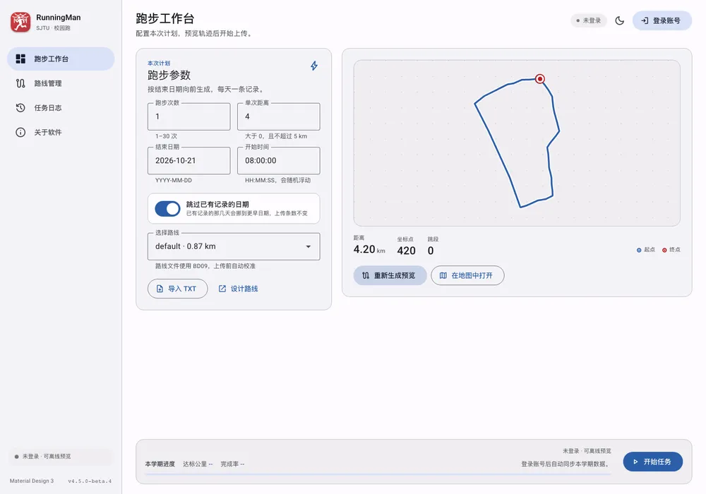
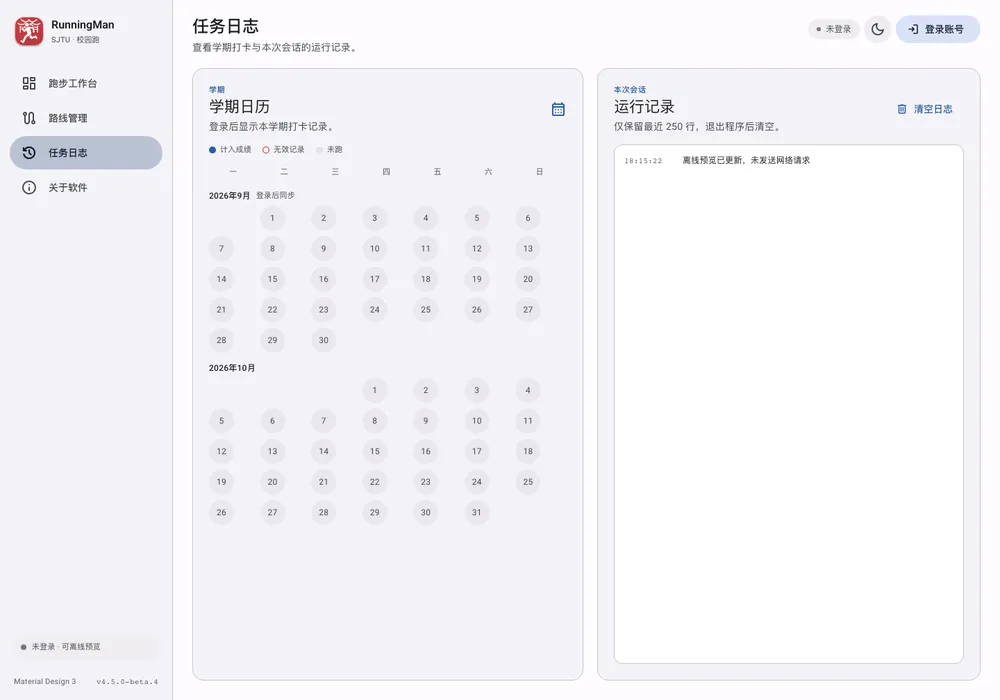
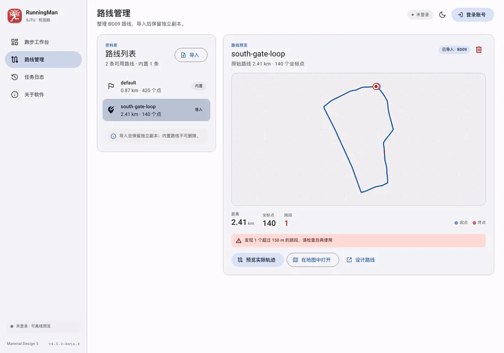

# Desktop (Windows / macOS / Linux)

The desktop client uses **Tauri 2 + React 19 + TypeScript + Rust**. The UI controls use Google's official [`@material/web`](https://github.com/material-components/material-web) components (including the labs card, navigation drawer and segmented button), with Material Design 3 colours, typography, shape, elevation and motion. The end-date picker, start-time picker and distance slider use third-party [material / md3.io](https://md3.io/) components. The Rust side keeps the existing business modules; `desktop/src-tauri/src/commands.rs` only adapts them to Tauri commands and state.

The app uses the system WebView: WebView2 on Windows, WKWebView on macOS and WebKitGTK on Linux. Frontend assets, the font subsets, routes and the planner are embedded in the executable at build time. No Chromium, Qt or Python is bundled. The old Python / Qt and Slint interfaces are retired.

## Screenshots

| Workbench | Semester calendar and log | Routes |
| --- | --- | --- |
|  |  |  |

## Interface

The permanent navigation drawer shows the original app icon and the `RunningMan` wordmark. The active page uses an MD3 secondary-container pill:

- **Workbench** — run parameters, route selection, semester progress and route preview.
- **Routes** — built-in / imported route list and route details.
- **Logs** — semester calendar on the left, session log on the right.
- **About** — version, update check, GitHub / Shuiyuan links with brand icons, usage and privacy notes. Update checks use the GitHub Releases API and fall back to the official releases feed when the API is rate limited or unavailable. No token is required. If both sources fail, open GitHub Releases manually.

The top-right corner only switches light/dark theme and signs in or out; the account status badge has been removed. The bottom-left corner masks the current account (for example, `zh***@sjtu.edu.cn`), with no full-email display or tooltip. Theme tokens are generated from the seed `#335C9C` with Google's official `material-color-utilities`; the old brand green is gone. The native title bar appearance and window background follow the theme as well, including the saved theme restored at startup.

Action results appear as a floating snackbar in the top-right corner of the workspace and disappear after six seconds. It is outside the layout flow and never pushes content down. The same text is always kept in the session log. While a task runs, a bottom bar shows progress and a stop button; other pages show a compact status bar.

## Usage

1. Set the run count (1–30), distance (using the md3.io slider with a vertical-bar handle, no dots or floating value bubble, and continuous adjustment from 0.1 to 5 km, a two-decimal display, immediate handle and track movement from the first press without a settling delay, and 0.01 km arrow-key adjustments (0.1 km with Shift)), end date (the md3.io centered calendar dialog, matching the start-time interaction and its 250 ms fade, upward movement and scale entrance (disabled for reduced motion), in `YYYY-MM-DD` format; select a date and confirm to apply, or cancel, press Escape or click outside to discard changes. Input mode is also available. Synced running days have solid underlines for credited records and dotted underlines for invalid records, with status tooltips; these dates remain selectable) and start time (clicking the field opens the compact md3.io 12-hour time picker; choose the hour, minute and AM/PM, with no seconds, or switch to the dial, then confirm; the field shows `hh:mm AM/PM`). The default end date is yesterday, and the defaults are 1 run, 4 km and `08:00 AM`; records are generated backwards from the end date. The summary at the top of the parameter card updates as you edit and restates the run count, total distance, end date and start time at a glance. In the single-column layout the date dialog and route dropdown remain visible above the preview card.
   "Skip dates with existing records" is enabled by default: such dates move to earlier days while the upload count stays the same. After login the client estimates the plan from the remaining semester distance unless the values were edited manually.
2. Pick the built-in “思源湖” (Siyuan Lake) route from "Current route" on the Workbench; import a BD09 TXT file from the Routes page (`longitude,latitude` per line, UTF-8, 2 MB / 30,000 points maximum). Imports keep an independent copy; only imported copies can be deleted.
3. The Workbench calculates the current route geometry locally and previews it automatically, with no regenerate button or stale-parameter notice. The online base map shown by default requires network access. Blue segments are normal; segments longer than 150 m are highlighted in red. Short open routes are repeated; closed loops cycle. Dragging the distance slider updates route geometry immediately with a smoothly moving endpoint and no top notice; changing runs, date or start time does not invalidate route geometry. The Workbench preview card starts with the track over an online base map, followed by distance, point count, jumps and action buttons. The route name appears in the route selector on the left.
4. Starting the app or entering a route page automatically loads the online map embedded in the preview card, using the current distance even before a sampled preview exists. The default view fits the complete route with margins similar to the local track preview; fractional zoom is used only to fit the route automatically, while trackpad, wheel and button interactions retain the map’s default zoom steps. The map is served by a loopback-only HTTP page and **uses OpenStreetMap only**, with no engine selector or loading status bar; the workbench has no "Collapse map" button, while Route management still lets you collapse to the local SVG preview and expand it again. If the map page cannot be loaded, the local preview remains available and you can retry. Online tiles require network, and failures are reported inside the card; Leaflet loads from unpkg. The page server listens on `127.0.0.1` only and keeps the HTML in memory; the map is available while the client is running.
5. "Design route" on the Routes page opens the planner in the browser (Baidu by default, OSM optional). Export TXT and import it through the app. `NeedsReview/` routes are not listed.
6. Sign in with JAccount. The graphical captcha is recognised by the legacy service and prefilled in an editable CAPTCHA field. If recognition fails, fill in the field manually or refresh to retry. Login is enabled only after the account, password and CAPTCHA are filled and CAPTCHA preparation has finished; incomplete input shows no missing-field error. IME confirmation never submits, while Enter submits a complete form. Editing clears the previous login error. Password visibility and CAPTCHA refresh do not submit the form. Two-factor verification via the SJTU app, email or SMS is supported when requested. Credentials and cookies stay in process memory.

Login dialog (CAPTCHA contents redacted):


7. The Workbench bottom bar shows semester distance, completion rate and synced running days, with a wavy semester progress indicator ported from Google’s Material Components Android source (Apache-2.0; TypeScript/Canvas2D adaptation, not an official Web component) replacing the separate semester card. The wave flows using the upstream time/phase algorithm (the app explicitly sets waveSpeed to 40 px/s; the Android default is 0). Progress uses the original spring logic and amplitude uses the original 500 ms easing transition: the semester bar configures the official amplitude range parameters to 0–100%, keeping waves at 9%, 99% and after completion. At 0% there is no completed segment; extremely short segments use the original merged-cap geometry. System reduced-motion disables animation. Signed-out users see placeholders and a login hint. The idle bar omits the ready and session-connected labels; running tasks still show their status and upload progress. The parameter card no longer includes an extra preview-check reminder. After previewing and confirming the parameters, start the task and confirm the dialog. Uploads run on a background thread and update progress and logs. A failed POST is never retried automatically. After a successful upload, semester statistics and the calendar refresh automatically.
8. "Stop task" prevents further uploads; an in-flight HTTP request is allowed up to 15 seconds. Closing the window while a task is running stops it first and exits after the current request.

The semester calendar uses **solid blue** for a counted run, **red outline** for an invalid record and **grey** for no record. Logs keep the last 250 lines in memory and are cleared on exit.

## Data and privacy

Account names, passwords, captchas and cookies/tokens live only in process memory and are cleared on sign-out or exit. Logs keep the last 250 lines and are not written to disk. Preferences never contain credentials. Semester statistics are display-only and fall back to placeholders after sign-out.

User data directory:

- Windows: `%LOCALAPPDATA%\sjtu\SJTURunningMan\data`.
- macOS: `~/Library/Application Support/cn.sjtu.SJTURunningMan`.
- Linux: `${XDG_DATA_HOME:-~/.local/share}/sjturunningman`.

It contains `settings.json` and `routes/`. Map HTML is served from memory by the on-demand local HTTP server and is never written to disk. Legacy `Routes/`, `user.txt` and `ui_settings.json` are not migrated automatically; import routes as TXT.

## Build and verification

Requires Rust 1.95+, Node.js 22+, pnpm 11.22.0 (pinned by `packageManager` in `desktop/package.json`) and the Tauri system dependencies (see [build.md](build.md)).

```bash
pnpm --dir desktop install --frozen-lockfile
pnpm --dir desktop tauri dev        # Vite on 1420 + Tauri window
pnpm --dir desktop build            # typecheck + production assets
cargo test --workspace --locked
cargo build --release --locked -p sjturunningman --features custom-protocol

./target/release/sjturunningman --smoke-test target/smoke
./target/release/sjturunningman --ui-smoke-test target/ui-smoke
```

> A bare `cargo run` is a Tauri development build and tries to connect to `http://localhost:1420`. Use `pnpm --dir desktop tauri dev`, or build a release binary with `--features custom-protocol`; without that feature the production asset protocol is not active.

On Windows, `./build_windows.ps1` builds the frontend first and produces `dist/SJTURunningMan.exe`. See [build.md](build.md) for the three-platform packaging commands. Automated checks never submit a real account or run record. See [desktop-validation.md](desktop-validation.md) and [testing.md](testing.md).

## Footprint

The desktop app does not bundle Chromium, Qt, Python or the old background assets; it uses the operating system WebView. The frontend is built by Vite and embedded in the binary. Roboto and Material Symbols are reduced to the subsets actually used (about 100 KB). Track previews load online base maps inside the card by default. Collapsing the map in Route management shows a local themed SVG preview, which is also retained if the map page fails to load. Authentication and upload requests only happen after user actions. Release builds use size optimisation, LTO and stripped symbols.

The workbench distance slider updates route geometry on every animation frame, with the endpoint moving smoothly along the route in either direction and a stable viewport. An open embedded map updates in place. Reduced motion skips the animation. The preview distance matches the selected distance, and neither frontend nor backend adds the former 200 m allowance; the displayed point count counts drawing vertices. The backend generates sampled tracks; the Routes page also previews automatically at the current per-run distance. Selecting, importing or deleting a route updates both the online map and local geometry without a manual preview action.

The consent dialog dims all background cards uniformly and aligns the checkbox with the first text line. Embedded maps report tile failures only when the settled viewport has no usable tiles, and clear the warning on recovery. Opening a map uses the current distance without a stale-preview notice.

When a batch finishes normally with at least one successful upload and no failures, bright confetti mixed with a few 🎉, 🏃, 🏅, ⭐, 🦄 and 💩 emoji bursts once from both bottom corners and clears after about 3 seconds without blocking controls. Stopped tasks, errors, partial failures, batches with no uploadable dates and offline previews do not trigger it. System reduced-motion skips the animation while retaining the temporary task result notice. Older system WebViews without emoji bitmap rendering retain the paper confetti.

The workbench footer shows task status only while a task is running. After completion, the status row disappears; semester progress and the start button remain, and a temporary notice shows the result.

Saved distances below 1.20 km are restored as 1.20 km. Automatic plans use the same 1.20–5.00 km limits. Recorded and credited distances are determined by the server and may differ from the local track distance.
